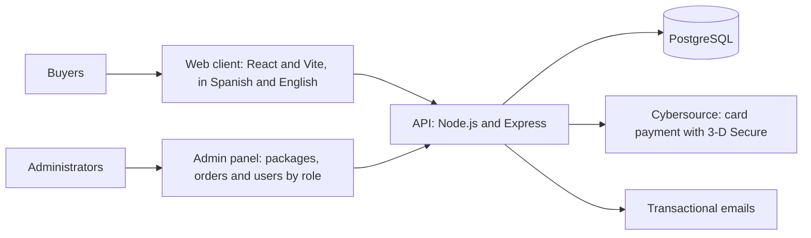

# Tranki: case study

> **Private code.** The source code belongs to the client and is not published. This repository is a case study: it describes the project at a high level, with no code, no screenshots and no internal details.

| | |
| --- | --- |
| **Year** | 2026 |
| **Status** | In production |
| **Live** | [tranki.care](https://tranki.care) |

## Context

Tranki is a marketplace of prepaid medical packages for the Honduran healthcare market: buyers pick packages for themselves or for their family.

## My role

Full-stack development of the platform: the storefront, the checkout and its payments, the API and the admin panel.

## Architecture

- A bilingual platform to browse and buy prepaid medical packages.
- The checkout registers one patient per package.
- Prices are computed on the server, with discounts by package or by age.
- Card payments are integrated with Cybersource and 3-D Secure.
- An admin panel manages packages, orders and users by role.

## Key features

- Catalog and checkout with one patient per package
- Server-side pricing
- Card payments (Cybersource, 3-D Secure)
- Orders with status history
- Role-based admin panel
- Transactional emails

## Stack

React · Vite · Tailwind CSS · Node.js · Express · PostgreSQL · JWT · Cybersource · Docker

## Results

In production at tranki.care, deployed with Docker Compose (Caddy, API and PostgreSQL).
